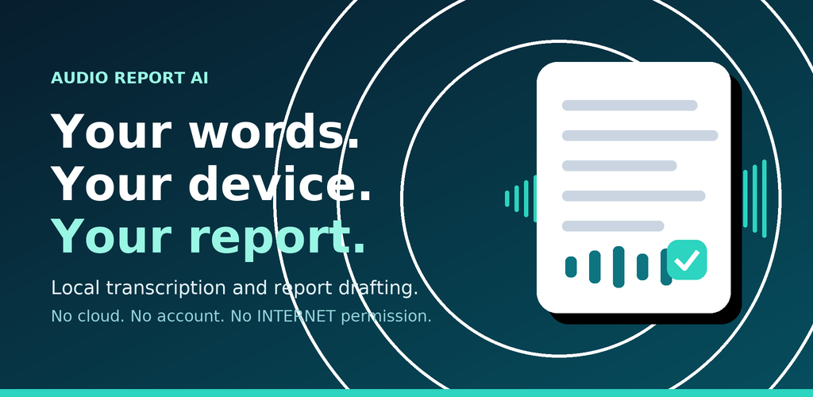
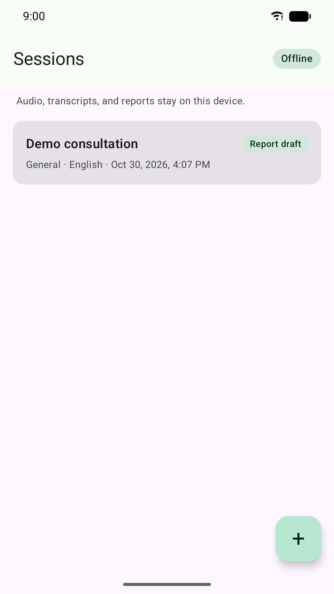
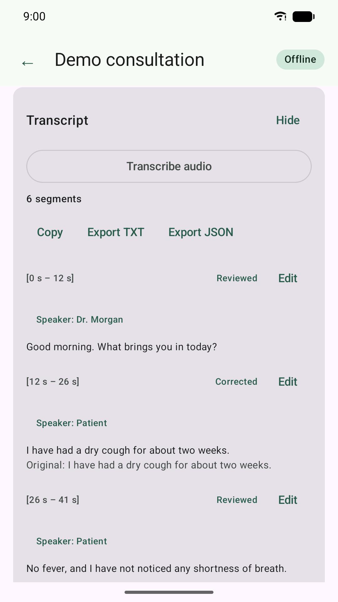
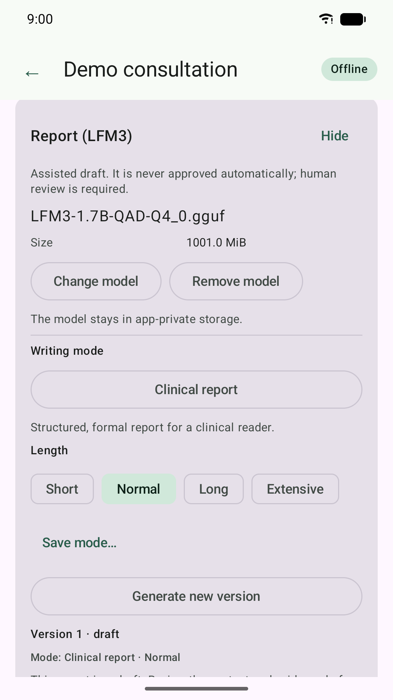
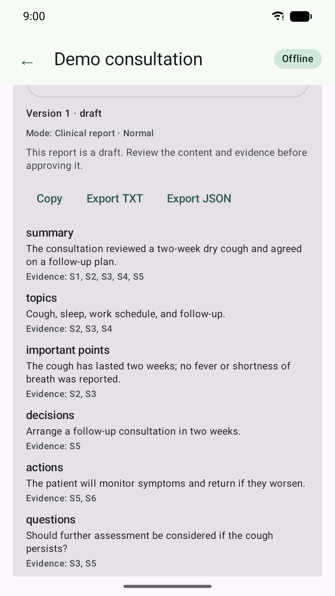

# Audio Report AI for Android

A local-first Android app for recording or importing conversations, transcribing
them on-device, reviewing the transcript, and drafting structured reports with a
local LFM3 model.

**No cloud. No account. No `INTERNET` permission.**



- Website: https://isasio.github.io/audio-report-ai-android/
- Privacy policy: https://isasio.github.io/audio-report-ai-android/privacy.html

## Download

**[Download the latest APK](https://github.com/isasio/audio-report-ai-android/releases/latest)**

- Version: **0.1.0**
- Package: `com.audioreportai.app`
- Size: **~1.1 GB**
- Android 10 or newer
- Architectures: arm64-v8a, x86_64

SHA-256:

```text
13da879f0af10e9a850100e59cb421869a99818c8a30daabe4c1fe544a0bdcac
```

## What it does

- Records audio with a visible foreground-service notification
- Imports MP3, M4A/AAC, WAV, and other platform-supported audio
- Normalises audio to 16 kHz mono WAV on-device
- Transcribes with a bundled whisper.cpp model
- Lets you review and correct the transcript while preserving the original text
- Supports manual speaker names and roles
- Drafts structured reports with a bundled LFM3-1.7B model
- Validates report sections against transcript evidence
- Keeps reports as drafts until a human explicitly approves them
- Supports short, normal, long, and extensive report lengths
- Includes formal, clinical, executive brief, veterinary SOAP, and saved custom modes
- Exports transcripts and reports as TXT or JSON through the Android file picker

## Bundled models

This APK includes:

| Model | Purpose | Approx. size |
| --- | --- | --- |
| LFM3-1.7B QAD Q4_0 GGUF | Report drafting | 1.05 GB |
| whisper tiny GGML | Transcription | 77 MB |

On first launch, the app copies the models into its private storage and shows a
progress screen. This happens once. The models are not downloaded from the
internet.

The bundled whisper model is the small **tiny** model. Transcription quality is
limited, especially for Spanish. You can import a larger whisper.cpp model from
device storage for better quality.

## Screenshots

Synthetic demo data; no patient information.

| Sessions | Transcript |
| --- | --- |
|  |  |

| Report settings | Report evidence |
| --- | --- |
|  |  |

## Requirements and installation

- Android 10 or newer
- A 64-bit device (arm64-v8a); x86_64 is supported for emulators
- About **3 GB free storage**: the 1.1 GB APK plus the first-launch model copy

1. Download the APK on the Android device.
2. Allow installation from your browser or file manager when prompted.
3. Open the app and wait for the one-time model preparation screen.
4. Create a session, then record or import audio.

If an older build signed with a different key is already installed, uninstall it
first. Android will otherwise reject the update, and uninstalling removes that
app's local data.

## Verify the download

```bash
sha256sum -c SHA256SUMS.txt
```

The current APK SHA-256 is also shown at the top of this page and in the release
notes.

## Troubleshooting

See [FAQ.md](FAQ.md) for installation/signature errors, storage requirements,
slow first launch, transcription quality, checksum verification, data deletion,
and support instructions.

## Privacy

- The app has **no `INTERNET` permission**. It cannot send audio, transcripts,
  reports, modes, or models to a server.
- No account, ads, analytics, telemetry, remote logging, or crash-reporting SDK.
- Audio, transcripts, reports, modes, and models remain in app-private storage.
- Files leave the app only when you explicitly export them through the Android
  system file picker.
- Deleting a session removes its audio, transcript, reports, and evidence from
  the app. Uninstalling removes all app-private data.

See [PRIVACY.md](PRIVACY.md) for details.

## Important limitations

Generated reports are drafts and must be reviewed,
corrected, and explicitly approved by a qualified person before use.

This is a 0.1.0 build. PDF export, richer report editing, and the final ASR
engine decision are not included yet.

## Licenses

The APK includes model and third-party license texts and an in-app **Licenses**
dialog. See:

- [THIRD_PARTY_NOTICES.txt](THIRD_PARTY_NOTICES.txt)
- [LICENSES](LICENSES)

The LFM3 model is redistributed under the **LFM Open License v1.0**, including
its commercial-use threshold. The whisper model is distributed under the MIT
License. This repository does not claim endorsement by Liquid AI or OpenAI.

## About this repository

This public repository only distributes the Android build and its user-facing
documentation. Source code, signing keys, and model files are not stored here.
The APK and its checksums are published as GitHub Release assets.

For support, open an issue in this repository:

https://github.com/isasio/audio-report-ai-android/issues

Never attach audio, transcripts, reports, patient names, or other clinical data.
